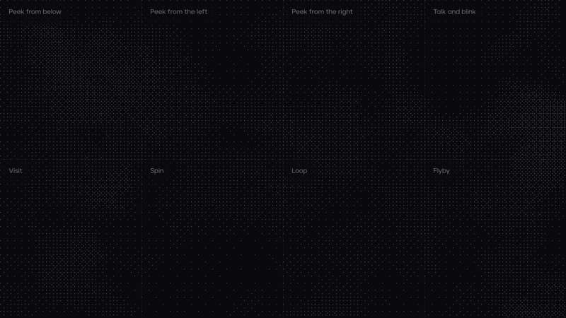
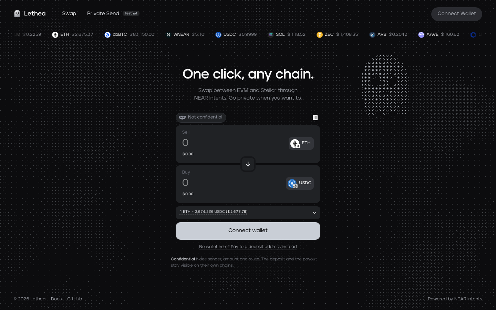
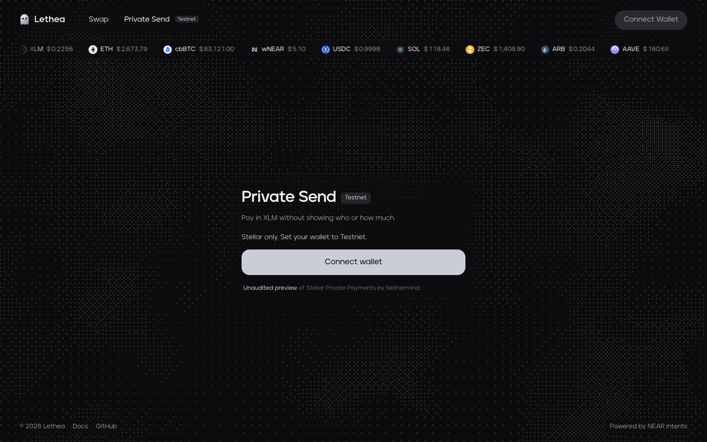
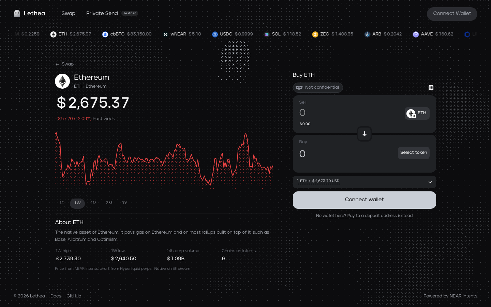
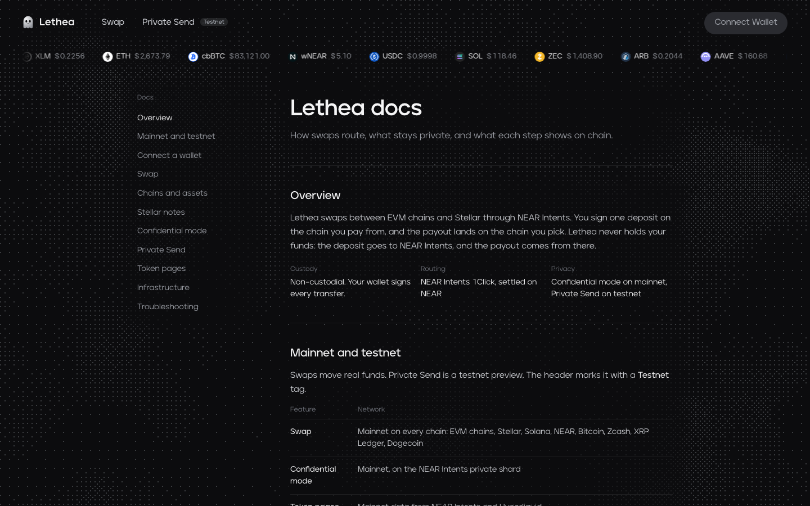
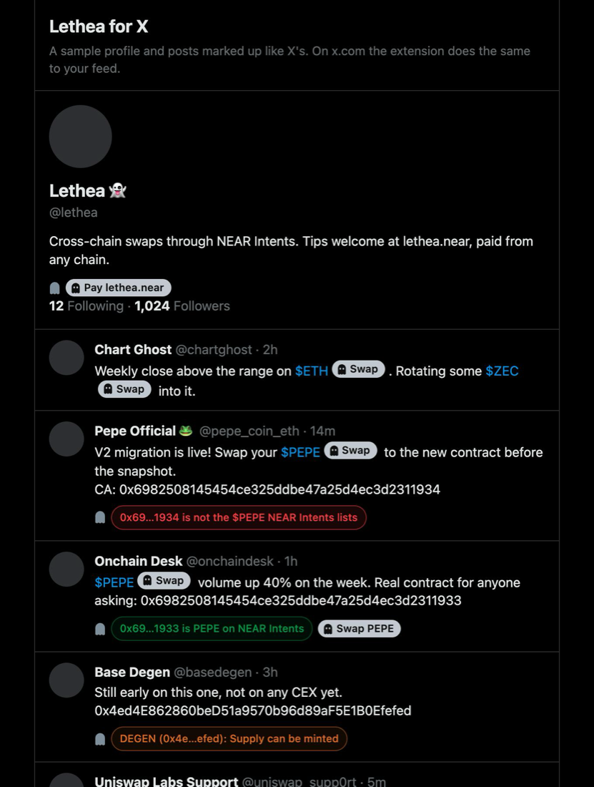

# Lethea

<p align="center">
  
</p>

Lethea is a cross-chain swap app with a privacy option. You pay from one chain, sign a single deposit, and receive on another. Routing and settlement go through [NEAR Intents](https://docs.near-intents.org), so Lethea never holds funds. Your wallet signs every transfer, and if a swap cannot be filled, NEAR Intents refunds the deposit to the address it came from.

The app is a static React site. It has no backend and stores no user data. Every request goes from the browser straight to the service it needs.

**Lethea for X** is a Chrome extension that brings the same swaps into your X feed. It adds a Swap button next to cashtags, checks the contract addresses and links in posts for scams, and adds a Pay button to profiles that list a wallet. See [Lethea for X](#lethea-for-x).



## What it does

### Swap

The swap box is Aurora's [Intents Swap Widget](https://github.com/aurora-is-near/intents-swap-widget) running in external wallet mode, with Lethea's own wallet picker around it. You choose a pair, read the quote, sign the deposit, and solvers compete to fill it. Quotes refresh every 15 seconds and slippage tolerance is 1%. Past swaps and their status show up in the widget's history view.

| Direction | Chains |
| --- | --- |
| Pay with a connected wallet | Stellar, Ethereum, Base, Arbitrum, Optimism, Polygon, BNB Chain, Avalanche, Solana, NEAR |
| Pay by deposit address | Bitcoin, Zcash, XRP Ledger, Dogecoin |
| Receive on | All of the above |

For Bitcoin, Zcash, XRP and Dogecoin there is no wallet to connect. The widget shows a one-time deposit address with a QR code, and you send from any wallet and give a refund address. On the receiving side you only need an address.

### Confidential mode

The widget has a Confidential toggle. With it on, the intent executes on a private NEAR shard run by permissioned validators, so the explorer does not show the route in between. The ends stay public, though. Anyone watching both chains can still see a deposit go in on one side and a payout come out on the other. The trust model is a TEE bridge plus a permissioned validator set, and there is no published independent audit yet.

### Private Send (testnet)

`/private` is a preview of [Stellar Private Payments](https://github.com/NethermindEth/stellar-private-payments), Nethermind's XLM privacy pool on Soroban. It runs on Stellar testnet only, it is unaudited, and it is off unless `VITE_ENABLE_SPP=true`.

One wallet signature derives your privacy keys and registers your public keys with the pool. After that you can deposit, send and withdraw. Each action builds a zero-knowledge proof in the browser with a WASM prover before it is submitted.

| Action | What is public |
| --- | --- |
| Deposit | Your address and the amount |
| Send | Neither the recipient nor the amount |
| Withdraw | The amount out, with no link to your deposit |

Notes and keys are tied to the wallet address, so switching wallets starts a separate private balance.



### Token pages and docs

The price strip at the top links to `/token/:symbol`. Each page shows the live price from NEAR Intents, a chart and 24h volume from Hyperliquid perpetual markets, the range high and low, and a swap box that targets that token. Stablecoins have no chart. `/docs` covers the same ground as this file from a user's point of view.

| Token page | Docs |
| --- | --- |
|  |  |

## Lethea for X



The extension in [`extension/`](extension) reads posts as X renders them and adds four things.

**Swap on cashtags.** A Swap button with the live price appears next to every cashtag that NEAR Intents lists, such as `$ETH`, `$ZEC` or `$PEPE`. Hovering it shows what $100 of BTC, ZEC or SOL buys right now, from dry 1Click quotes, and how long each route takes. Clicking it opens `lethea.xyz/buy/<chain>/<symbol>` in a small popup with the token already selected, and you can pay from any chain Lethea supports, Bitcoin, Zcash and XRP included. When a symbol is listed on several chains, the native asset wins. The button always buys the asset NEAR Intents lists, never an address written in the post.

**A share for the post's author.** If the author of the post has a `.near` account in their X name, such as `Alice · alice.near`, 0.1% of a swap opened from that post goes to that account. It is paid through NEAR Intents' `appFees`, so the intent pays it when it settles and Lethea never holds it. The buy page first checks that the account exists, and names the fee on the fee line in the quote details. Writers who put a `.near` name on X earn from the trades their posts start.

**Scam checks under posts.** These show up under any post that has a contract address or an outside link:

| Check | How |
| --- | --- |
| A contract posing as a listed token | The post names `$PEPE`, but its address is not the PEPE contract NEAR Intents lists |
| A contract NEAR Intents lists | Marked as the listed token, with its own Swap button |
| Any other EVM or Solana contract | [GoPlus](https://gopluslabs.io) token security: honeypots, sell limits, high taxes, hidden owners, mint and freeze authority, holder count |
| Look-alike domains | A domain that names a brand without being one of its domains, such as `uniswap-rewards.xyz`, or one that uses punycode |
| Known phishing sites | GoPlus's phishing list |
| Airdrop and claim bait | A post that talks about airdrops, claims or connecting a wallet and links to an unknown site |

If you press Swap on a post that has a red flag, the buy page repeats the warning above the swap box.

**Pay on profiles.** On a profile page, the extension looks for a `.near` or `.eth` name, or an EVM, Solana, Stellar or Bitcoin address, in the name, bio and website. It adds a Pay button under the bio for each one. The button opens `lethea.xyz/pay/<handle>?to=<address>`, where you pay with any token from any chain and the payee receives on their own chain. Confidential mode keeps the route between the two chains private. The pay page does not trust the link. It resolves ENS names, checks that NEAR accounts exist, and asks you to compare the address with the profile, since anyone can write a pay link.

### Install

1. Open `chrome://extensions` and turn on Developer mode.
2. Click **Load unpacked** and choose the `extension` folder.
3. Open x.com. Clicking the extension's toolbar icon opens a demo page with a sample profile and posts, so you can try it without an X account.

The Swap and Pay buttons open `https://lethea.xyz`. To point them at a local `npm run dev`, change `LETHEA_URL` at the top of [`extension/background.js`](extension/background.js) to `http://localhost:5173`.

### What it sends where

The extension has no server and keeps nothing on disk. It fetches the NEAR Intents token list and, when you hover a Swap button, dry quotes from 1Click. It sends contract addresses and link domains from posts you scroll past to GoPlus, and opens Lethea with the token, the post, the author's `.near` account or the payee in the URL. It reads both of X's current page builds: the older one with `data-testid` attributes and the late-2026 one without them.

### Limits

- Swap buttons only appear for tokens NEAR Intents lists, about 90 on the chains Lethea routes to. New memecoins get a GoPlus check but no button.
- GoPlus's free tier is rate limited, so the extension checks one address at a time and keeps the results while the browser is open.
- The scam checks are heuristics. A green check means NEAR Intents lists the contract, not that the token is a good buy.
- Pay only works for profiles that list a wallet. Paying any X handle, with funds held until the owner claims them, is future work.

## Wallets

Wallet connections use open source libraries with no hosted relay in between. WalletConnect is not included, so mobile wallets cannot connect over QR.

| Chain | Library | Examples |
| --- | --- | --- |
| EVM | wagmi, EIP-6963 discovery | MetaMask, Rabby, Phantom |
| Stellar | Stellar Wallets Kit | Freighter, xBull, Lobstr |
| Solana | Solana Wallet Adapter | Phantom, Solflare, Backpack |
| NEAR | NEAR Connect | HOT, Meteor, Intear, MyNearWallet |

## Running locally

You need Node 20 or newer.

```bash
npm install
cp .env.example .env
npm run dev
```

| Variable | Required | Purpose |
| --- | --- | --- |
| `VITE_INTENTS_API_KEY` | Yes | NEAR Intents key from [studio.aurora.dev](https://studio.aurora.dev) |
| `VITE_ALCHEMY_API_KEY` | No | EVM token balances in the swap box |
| `VITE_ENABLE_SPP` | No | `true` turns on Private Send. Keep it `false` on mainnet builds |
| `VITE_FEE_ACCOUNT` | No | NEAR account that receives Lethea's 0.1% on swaps opened from X. Without it Lethea takes nothing |

`.env.example` also lists `VITE_REOWN_PROJECT_ID`. The current code does not read it.

Without an API key the widget still loads its token list but returns no quotes. That is enough for UI work:

```bash
VITE_INTENTS_API_KEY=preview-only npm run dev
```

Other scripts:

```bash
npm run build     # type check, then production build into dist/
npm run preview   # serve the production build
npm run lint      # oxlint
```

## Deploying

The build is plain static files. Two things matter on the host:

1. The router uses the History API, so `/token/*`, `/buy/*`, `/pay/*`, `/docs` and `/private` need an SPA rewrite to `index.html`.
2. `public/spp/` has to be served as is. The Private Send SDK loads its JS, WASM, proving key and workers from there at runtime, outside the bundler.

## Project layout

```
src/
  main.tsx              loads polyfills, then imports bootstrap.tsx
  bootstrap.tsx         wallet providers and the app root
  pages/                SwapPage (shell and routes), TokenPage, BuyPage, PayPage, PrivatePage, DocsPage, swap.css
  components/           SwapBox, WalletPicker, Ticker, PriceChart, DitherField (animated background)
  intents/              widget configuration (chains.ts holds the chain lists), defaults, signers
  wallets/              one provider and hook per chain
  spp/client.ts         Private Send SDK loader and session
  lib/                  router, token list, swap history, theme, formatting
public/
  fonts/                Jeko
  spp/                  vendored Stellar Private Payments SDK and testnet deployments.json
extension/              Lethea for X: manifest, background.js (network), content.js (page), demo.html
brand/                  logo source images and make-logo.py
docs/media/             README screenshots and the ghost GIF
```

## Notes for contributors

- `main.tsx` imports the Buffer and process polyfills first and then loads `bootstrap.tsx` with a dynamic import. A static import breaks the app, because Rolldown hoists chunks above the polyfill.
- `vite.config.ts` aliases `algosdk` to its ESM build. The widget pulls it in through Wormhole, and Rolldown cannot resolve its `browser` field.
- If Vite fails to load after a dependency change, clear its optimizer cache with `npx vite --force`.
- Nethermind redeploys the testnet contracts from time to time. When that happens, copy the SDK from their hosted demo into `public/spp/dist` and replace `public/spp/deployments.json` with the one from their repo. The npm package `stellar-private-payments@0.1.0` is behind and fails against the current pool.

## Status

Swaps run on mainnet. NEAR Intents has no testnet, so the extension's Swap and Pay buttons lead to real mainnet swaps. Private Send is a testnet preview built on unaudited contracts, so do not use it with real funds.

## NEAR HACKATHON

Lethea for X was built for [NEAR HACKATHON](https://nearhackathon.com) (1 to 14 November 2026). It is entered in the Unstoppable DeFi track, as trading that settles across chains through NEAR Intents, and in Open Innovation, as chain abstraction in the place people already talk about tokens.

Lethea itself existed before the hackathon. The swap site, wallets, token pages and Private Send were built in September and October 2026, and the `pre-hackathon` tag marks where that work ends. Everything after it, on the `near-hackathon` branch, was built during the hackathon: [compare `pre-hackathon` with `near-hackathon`](https://github.com/utkurock/lethea/compare/pre-hackathon...near-hackathon).

New in the hackathon window:

- The Lethea for X extension: Swap buttons with live quotes on cashtags, the scam checks, and Pay buttons on profiles
- Fee sharing with post authors who have a `.near` name, through NEAR Intents `appFees`
- `/buy/:chain/:symbol` and `/pay/:handle` on the site, sized for the extension's popup
- A fixed-recipient mode and app fees for the swap box, used by the pay and buy pages
- A fix for the background canvas in windows that open at zero size

Services and libraries the new work uses: the NEAR Intents 1Click token list and quote API, Aurora's Intents Swap Widget (already in Lethea), the GoPlus Security API, FastNEAR's public RPC for NEAR account checks, and wagmi/viem for ENS names. None of them is a template; the extension is plain JavaScript with no build step.
